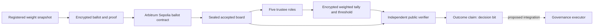

# Enforced Winner-Only Disclosure: Verifiable Tally Hiding for Weighted On-Chain Governance

Jiayu Li and Gongli Li · Henan Normal University · [IACR Cryptology ePrint 2026/1773](https://eprint.iacr.org/2026/1773) · BlockSys 2027 · [Submission PDF](paper/BlockSys2027_submission.pdf)

This repository contains the reference implementation and reproducibility materials for encrypted weighted voting. It shows how to verify a governance outcome without publishing the exact weighted tally. It is a research prototype, not production DAO voting software.

## Why hide the tally?

When voter weights are public or linkable, the exact weighted tally can reveal individual choices. With weights `7, 4, 1`, for example, publishing a “yes” tally of `8` identifies the voters with weights `7` and `1` as the yes voters. Publishing only the threshold outcome avoids releasing that exact sum.

The protocol keeps each weighted contribution encrypted through aggregation and threshold comparison. A public verifier checks that the computation used exactly the ballots accepted by the contract, while trustees release only the decision bit.

## Contributions

- **Registered-weight certified ballots:** each zero-knowledge ballot binds an encrypted binary vote to its registered weight.
- **Encrypted weighted-threshold computation:** tally and comparison use the Cortier–Gaudry–Yang (CGY) verifiable tally-hiding toolbox.
- **Exact accepted-board binding:** backend computation is bound to ciphertext coordinates accepted and sealed by the contract.
- **Independent public replay:** anyone with public run artifacts can verify ballot proofs, board binding, the CGY transcript, and the final release.
- **Decision-bit-only release:** the reference run requires all five trustee shares to open only the outcome bit.

## Architecture



The contract, local CGY backend, public replay, and outcome claim are implemented. The reference code models five trustee roles in one process; it does not provide production trustee isolation. The governance executor is a proposed integration boundary, not part of this implementation.

## Quick start

Install Node.js 20 or later, Rust/Cargo 1.98.1, and Circom 2.1.6. From a clean Windows PowerShell checkout, this command installs locked dependencies, builds the native backend, creates fresh **test-only** Groth16 artifacts, and runs a verified local `n=8` experiment:

```powershell
.\scripts\reproduce.ps1 -Sizes 8 -BuildArtifacts
```

After setup, run additional sizes with:

```powershell
.\scripts\reproduce.ps1 -Sizes 8,64,256,1024
```

Bash entry point: `bash scripts/reproduce.sh 8,64,256,1024`. These commands create fresh validation runs; they do not reproduce the historical timings in the included PDF. Detailed setup, outputs, resource estimates, and public-chain instructions are in [docs/quickstart.md](docs/quickstart.md) and [docs/experiments.md](docs/experiments.md).

## Results in the submission PDF

The included BlockSys 2027 PDF reports the historical five-of-five Q5 series. These are the measurements in its Table 1, read from the run manifests pinned by the [evidence v1 archive](https://github.com/CryptographyBloke/Enforcing-Winner-Only-Disclosure-Verifiable-Tally-Hiding-for-Weighted-DAO-Governance/releases/tag/blocksys2027-evidence-v1).

| n | gates | depth | proving (s) | admission (s) | Rust backend (s) | release (s) | replay (s) | total (s) |
|---:|---:|---:|---:|---:|---:|---:|---:|---:|
| 8 | 134 | 72 | 10.04 | 0.15 | 4.05 | 6.93 | 0.92 | 22.12 |
| 64 | 1,086 | 147 | 146.51 | 1.28 | 15.98 | 8.93 | 11.68 | 184.41 |
| 256 | 4,350 | 207 | 368.45 | 5.22 | 47.13 | 8.40 | 32.91 | 462.13 |
| 1,024 | 17,406 | 275 | 1,414.93 | 19.16 | 156.72 | 4.57 | 114.54 | 1,709.95 |

The source, machine, and run IDs are historical. Totals follow the Q5 manifest `totalSeconds` field, which includes a small setup interval not shown as a separate column. The table is not a performance claim about a new host or a fresh run of the maintained checkout. New local runs validate the current implementation and are kept separate from the paper measurements. See [the experiment guide](docs/experiments.md) and [version provenance](docs/provenance.md).

## TCP transcript transport experiment

NETWORK-02 replayed the existing signed trustee messages through five TCP client processes and a separate persistent board service. The experiment measures transport, board persistence, and public replay; its clients transport public records from the local CGY source run.

| n | Target RTT | Measured RTT median (p95) | TCP wall median (range) | Seals | TCP application bytes |
|---:|---:|---:|---:|---:|---:|
| 8 | 0 ms | 0.194 (0.495) ms | 8.269 (8.136–9.180) s | 1,614 | 67,767,585 |
| 8 | 20 ms | 31.227 (39.989) ms | 57.431 (57.418–57.891) s | 1,614 | 67,768,165 |
| 8 | 100 ms | 116.213 (126.381) ms | 195.861 (194.678–196.362) s | 1,614 | 67,768,745 |
| 64 | 0 ms | 0.199 (0.332) ms | 74.509 s | 13,038 | 548,458,033 |
| 64 | 20 ms | 31.091 (39.614) ms | 469.832 s | 13,038 | 548,458,613 |

Each n=8 profile has three successful runs; each n=64 profile has one. The n=64, 100 ms profile remains unmeasured. Byte totals count TCP application framing, including board fan-out. They exclude packet headers. The trustee clients replayed centrally generated signed records, so these figures describe authenticated transcript transport and replay. See [the full report](reports/NETWORK-02.md) and [the insertion-ready manuscript fragment](paper/network_results.tex).

Download the [public NETWORK-02 evidence bundle](https://github.com/CryptographyBloke/Enforcing-Winner-Only-Disclosure-Verifiable-Tally-Hiding-for-Weighted-DAO-Governance/releases/tag/network-02-tcp-transport-v1). Its index contains SHA-256 hashes for every exported file.

## Security scope

The paper proves accepted-result correctness even with malicious trustees, restricted-I/O SUC security against a static active coalition smaller than the five-share decryption threshold, and a winner-only disclosure corollary for the actual sealed board. The implementation's five trustee roles are co-located and use test-only setup; this is not distributed key generation or a production deployment. See [docs/security-model.md](docs/security-model.md).

## Arbitrum Sepolia reference

The archived `n=8` testnet experiment used chain ID `421614`, accepted eight ballots, and records a public replay and outcome claim. It is a testnet reference, not production Arbitrum DAO governance. Its public-chain threshold is `tau=500`; local scale runs use `floor(255*n/4)`, giving `tau=510` at local `n=8`. The local reproduction command submits no chain transactions. See [docs/experiments.md](docs/experiments.md#fresh-arbitrum-sepolia-experiment).

## Repository map

| Path | Contents |
|---|---|
| [`protocol/`](protocol/package.json) | JavaScript protocol, ballot orchestration, public replay, and tests |
| [`native/`](native/Cargo.toml) | Rust CGY gate engine, scheduler, and transcript tools |
| [`circuits/`](circuits/package.json) | Circom ballot relation and pinned circuit dependency |
| [`contracts/arbitrum/`](contracts/arbitrum/package.json) | Arbitrum ballot contract, board binding, fixtures, and Hardhat tests |
| [`configs/reference/`](configs/reference/five_of_five_n8.json) | Five-of-five parameters and local sizes |
| [`scripts/`](scripts/reproduce.ps1) | Setup, reproduction, verification, summaries, and safe exports |
| [`docs/`](docs/architecture.md) | Protocol, security, reproduction, mapping, and provenance guides |
| [`evidence/`](evidence/README.md) | Hash and link for the archived paper evidence |
| `runs/` | Ignored new experiment output; only `runs/README.md` is tracked |

## License and citation

Code is licensed under [GPL-3.0](LICENSE). The CGY toolbox is credited to Véronique Cortier, Pierrick Gaudry, and Quentin Yang; see their [IACR ePrint 2021/491](https://eprint.iacr.org/2021/491).

```bibtex
@misc{li2026enforcing,
  author       = {Jiayu Li and Gongli Li},
  title        = {Enforced Winner-Only Disclosure: Verifiable Tally Hiding for Weighted On-Chain Governance},
  howpublished = {Cryptology ePrint Archive, Paper 2026/1773},
  year         = {2026},
  url          = {https://eprint.iacr.org/2026/1773}
}
```

For source and evidence history, see [docs/provenance.md](docs/provenance.md). For paper-to-code pointers, see [docs/paper-to-code.md](docs/paper-to-code.md).
