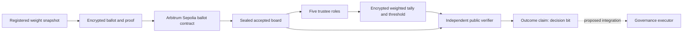

# Enforced Winner-Only Disclosure

**Verifiable Tally Hiding for Weighted DAO Governance**

Jiayu Li and Gongli Li · Henan Normal University · [IACR Cryptology ePrint 2026/1773](https://eprint.iacr.org/2026/1773) · BlockSys 2027

This repository contains the reference implementation and reproducibility materials for encrypted weighted voting. It shows how to verify a governance outcome without publishing the exact weighted tally. It is a research prototype, not production DAO voting software.

## Why hide the tally?

When voter weights are public or linkable, the exact weighted tally can reveal individual choices. With weights `7, 4, 1`, for example, publishing a “yes” tally of `8` identifies the voters with weights `7` and `1` as the yes voters. Publishing only the threshold outcome avoids releasing that exact sum.

The protocol keeps each weighted contribution encrypted through aggregation and threshold comparison. A public verifier checks that the computation used exactly the ballots accepted by the contract, while trustees release only the decision bit.

## Contributions

- **Registered-weight certified ballots:** each zero-knowledge ballot binds an encrypted binary vote to its registered weight.
- **Encrypted weighted-threshold computation:** tally and comparison use the Cortier–Gaudry–Yang (CGY) verifiable tally-hiding toolbox.
- **Exact accepted-board binding:** backend computation is bound to ciphertext coordinates accepted and sealed by the contract.
- **Independent public replay:** anyone with public run artifacts can verify ballot proofs, board binding, the CGY transcript, and the final release.
- **Decision-bit-only release:** the reference run requires all five trustee shares to open only the outcome bit.

## Architecture



The contract, local CGY backend, public replay, and outcome claim are implemented. The reference code models five trustee roles in one process; it does not provide production trustee isolation. The governance executor is a proposed integration boundary, not part of this implementation.

## Quick start

Install Node.js 20 or later, Rust/Cargo 1.98.1, and Circom 2.1.6. From a clean Windows PowerShell checkout, this command installs locked dependencies, builds the native backend, creates fresh **test-only** Groth16 artifacts, and runs a verified local `n=8` experiment:

```powershell
.\scripts\reproduce.ps1 -Sizes 8 -BuildArtifacts
```

After setup, run additional sizes with:

```powershell
.\scripts\reproduce.ps1 -Sizes 8,64,256,1024
```

Bash entry point: `bash scripts/reproduce.sh 8,64,256,1024`. Detailed setup, outputs, resource estimates, and public-chain instructions are in [docs/quickstart.md](docs/quickstart.md) and [docs/experiments.md](docs/experiments.md).

## Fresh local runs

The cleaned implementation completed fresh local runs at all four sizes on 2026-11-19. Every run passed ballot verification, exact board binding, five-of-five release, independent public replay, and isolated oracle comparison.

| n | gates | depth | proving | Rust backend | complete pipeline | verification |
|---:|---:|---:|---:|---:|---:|:---:|
| 8 | 134 | 72 | 17.947 s | 5.302 s | 38.645 s | PASS |
| 64 | 1,086 | 147 | 150.325 s | 24.397 s | 226.338 s | PASS |
| 256 | 4,350 | 207 | 592.009 s | 83.640 s | 886.193 s | PASS |
| 1,024 | 17,406 | 275 | 2,363.563 s | 322.893 s | 3,507.043 s | PASS |

These are new cleaned-workspace measurements, not historical Q5 results. The gate counts and depths match; the larger runs are materially slower than the historical measurements and the cause has not been isolated. See the [fresh evidence release](https://github.com/CryptographyBloke/Enforcing-Winner-Only-Disclosure-Verifiable-Tally-Hiding-for-Weighted-DAO-Governance/releases/tag/blocksys2027-evidence-v2-cleaned-local-2026-11) and [full phase table](docs/experiments.md#fresh-cleaned-workspace-runs-2026-11-19). The paper's historical timings below remain the authoritative Q5 measurements.

## Historical Q5 measurements

These are published measurements from the frozen Q5 source and original workstation. They are not runs of the cleaned checkout. Timings vary by machine.

| n | gates | depth | ballot proving | backend | producer replay | total |
|---:|---:|---:|---:|---:|---:|---:|
| 8 | 134 | 72 | 10.044 s | 4.055 s | 0.919 s | 22.123 s |
| 64 | 1,086 | 147 | 146.507 s | 15.981 s | 11.684 s | 184.408 s |
| 256 | 4,350 | 207 | 368.449 s | 47.129 s | 32.910 s | 462.134 s |
| 1,024 | 17,406 | 275 | 1,414.928 s | 156.715 s | 114.540 s | 1,709.946 s |

Phase data is in [`evidence/data/performance_local.csv`](evidence/data/performance_local.csv). The original archive and hashes are preserved in the [blocksys2027-evidence-v1 release](https://github.com/CryptographyBloke/Enforcing-Winner-Only-Disclosure-Verifiable-Tally-Hiding-for-Weighted-DAO-Governance/releases/tag/blocksys2027-evidence-v1). New runs are written under ignored `runs/` directories and summarized from generated artifacts; these historical values are never used as fresh results.

## Security scope

The paper proves accepted-result correctness even with malicious trustees, restricted-I/O SUC security against a static active coalition smaller than the five-share decryption threshold, and a winner-only disclosure corollary for the actual sealed board. The implementation's five trustee roles are co-located and use test-only setup; this is not distributed key generation or a production deployment. See [docs/security-model.md](docs/security-model.md).

## Arbitrum Sepolia reference

The archived `n=8` testnet experiment used chain ID `421614`, accepted eight ballots, and records a public replay and outcome claim. It is a testnet reference, not production Arbitrum DAO governance. Its public-chain threshold is `tau=500`; local scale runs use `floor(255*n/4)`, giving `tau=510` at local `n=8`. The local reproduction command submits no chain transactions. See [docs/experiments.md](docs/experiments.md#fresh-arbitrum-sepolia-experiment).

## Repository map

| Path | Contents |
|---|---|
| [`protocol/`](protocol/package.json) | JavaScript protocol, ballot orchestration, public replay, and tests |
| [`native/`](native/Cargo.toml) | Rust CGY gate engine, scheduler, and transcript tools |
| [`circuits/`](circuits/package.json) | Circom ballot relation and pinned circuit dependency |
| [`contracts/arbitrum/`](contracts/arbitrum/package.json) | Arbitrum ballot contract, board binding, fixtures, and Hardhat tests |
| [`configs/reference/`](configs/reference/five_of_five_n8.json) | Five-of-five parameters and local sizes |
| [`scripts/`](scripts/reproduce.ps1) | Setup, reproduction, verification, summaries, and safe exports |
| [`docs/`](docs/architecture.md) | Protocol, security, reproduction, mapping, and provenance guides |
| [`evidence/`](evidence/README.md) | Historical Q5 records, frozen source, and verification instructions |
| `runs/` | Ignored new experiment output; only `runs/README.md` is tracked |

## License and citation

Code is licensed under [GPL-3.0](LICENSE). The CGY toolbox is credited to Véronique Cortier, Pierrick Gaudry, and Quentin Yang; see their [IACR ePrint 2021/491](https://eprint.iacr.org/2021/491).

```bibtex
@misc{li2026enforcing,
  author       = {Jiayu Li and Gongli Li},
  title        = {Enforcing Winner-Only Disclosure: Verifiable Tally Hiding for Weighted {DAO} Governance},
  howpublished = {Cryptology ePrint Archive, Paper 2026/1773},
  year         = {2026},
  url          = {https://eprint.iacr.org/2026/1773}
}
```

For source and evidence history, see [docs/provenance.md](docs/provenance.md). For paper-to-code pointers, see [docs/paper-to-code.md](docs/paper-to-code.md).
