# Architecture

## Data and trust boundaries

```mermaid
flowchart LR
  R[Registered weight snapshot] --> P[Encrypted ballot plus zero-knowledge proof]
  P --> C[Arbitrum Sepolia ballot contract]
  C --> B[Exact sealed accepted board]
  B --> T[Trustee roles: 1 through 5]
  T --> G[CGY encrypted tally and threshold circuit]
  G --> J[Canonical gate transcript]
  B --> V[Independent public verifier]
  J --> V
  V --> F[Five-of-five decision-bit release]
  F --> O[Outcome claim]
  O -. proposed .-> X[Governance executor]
```

The registered-weight snapshot is an input to ballot generation and admission. A ballot proves that its encrypted contribution is either zero or the registered weight. The contract verifies the proof, rejects duplicate nullifiers, and accumulates the exact accepted ciphertext coordinates into a sealed board.

The tally backend operates over that board. It aggregates encrypted weighted contributions and evaluates the threshold using CGY conditional gates. Each trustee role contributes authenticated protocol messages to the canonical broadcast transcript. The final release rerandomizes the logical decision ciphertext and verifies all five decryption shares before opening one bit.

The public verifier rechecks the board binding, the source gate transcript, and the final release. The contract records an outcome claim and its transcript hash; the contract itself does not execute the governance proposal or replay the backend transcript. Public replay supplies the independent check. An executor that consumes the verified claim is a proposed integration.

## What is implemented

| Component | Status |
|---|---|
| Weighted ballot relation, Groth16 verifier, admission checks | Implemented |
| `StrongN8Poll` contract and exact accepted-board binding | Implemented for the `n=8` Arbitrum Sepolia reference |
| Rust CGY gate engine and weighted arithmetic scheduler | Implemented |
| Five trustee roles and five-of-five final release | Implemented as a co-located test/reference run |
| Independent local and public-chain replay tools | Implemented |
| Production trustee deployment, DKG, and governance executor | Proposed or out of scope |

## Deployment views

The local scale runner replaces only the bounded chain transport with a sealed local board. It still generates and verifies ballots, runs admission, computes over the accepted ciphertexts, seals the board, runs Rust CGY gates, opens the result with five shares, and replays the public transcript. The Arbitrum Sepolia `n=8` pipeline exercises the contract and chain path. It is a testnet experiment and does not represent production Arbitrum DAO governance.

The implementation runs all trustee roles in a single operating-system process. The protocol's security statement and this prototype's deployment properties are distinct; see [security-model.md](security-model.md).
